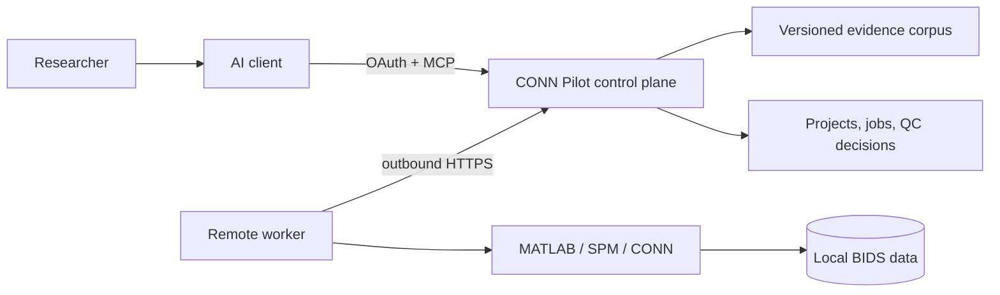

# CONN Pilot

CONN Pilot is a research-oriented assistant for designing, executing, reviewing,
and documenting reproducible functional-connectivity analyses with
[CONN Toolbox](https://web.conn-toolbox.org/). It combines a deterministic
analysis engine with a versioned evidence corpus and a remote
[Model Context Protocol](https://modelcontextprotocol.io/) (MCP) interface that
can be used from supported AI clients.

> **Research preview.** CONN Pilot is not a clinical device and is not an
> official CONN Toolbox product. A technically successful run or a statistically
> significant result is not, by itself, evidence that a scientific hypothesis is
> true.

## What a researcher can do

- Design a supported resting-state fMRI experiment through conversation.
- Compare literature-reported preprocessing and denoising options.
- Record the selected value, rationale, evidence identifiers, and corpus version.
- Run a validated seed-to-voxel or ROI-to-ROI pipeline on a registered BIDS dataset.
- Monitor the remote worker without exposing source images or local filesystem paths.
- Review subject-level QC, revise the analysis sample, and recalculate the second level.
- Export a versioned reproducibility package with methods, decisions, artifacts, and hashes.

The current validated scope is one-session, raw-BIDS resting-state fMRI in MNI
space, using one-sample or two-independent-group designs. Longitudinal designs,
repeated measures, arbitrary MATLAB, and subject-specific ROI files remain
outside the executable contract.

## Start here

| Reader | Entry point |
| --- | --- |
| Researcher | [Researcher quickstart](docs/researcher-quickstart.md) |
| Scientist evaluating the method | [Scientific documentation map](docs/README.md) |
| Scientist auditing every module | [Detailed scientific module reference](docs/science/scientific-modules.md) |
| AI assistant configuring access | [AI-assisted setup](docs/integrations/ai-assisted-setup.md) |
| ChatGPT or Codex user | [OpenAI clients](docs/integrations/openai-clients.md) |
| Claude or Claude Code user | [Claude clients](docs/integrations/claude.md) |
| Copilot Studio or Microsoft 365 Copilot user | [Microsoft clients](docs/integrations/microsoft-copilot.md) |
| Contributor | [Contributing](CONTRIBUTING.md) |

## One endpoint, individual identity

The research-preview MCP endpoint is:

```text
https://control-plane-production-0adf.up.railway.app/mcp
```

It uses OAuth. Each researcher receives a separate allowlisted identity and
authenticates in the browser; passwords, one-time codes, access tokens, and
client secrets do not belong in this repository or in an AI conversation.

An AI assistant can configure the connection from the files in this repository.
For example, Codex can use:

```powershell
codex mcp add conn-pilot `
  --url https://control-plane-production-0adf.up.railway.app/mcp `
  --oauth-client-registration dcr
codex mcp login conn-pilot --oauth-client-registration dcr
```

After authentication, a safe first request is:

> Use CONN Pilot to show my identity-scoped capabilities, available datasets,
> supported analysis families, and current worker health. Do not create or run a
> project yet.

## How the system is separated



The AI interprets the research question and explains options. The server validates
contracts, preserves provenance, and enforces identity boundaries. The worker
executes a frozen plan locally. Source neuroimages remain on the worker machine;
the control plane receives a sanitized inventory and selected result artifacts.

## Scientific guarantees and limits

CONN Pilot separates four judgments that are often conflated:

1. **Technical completion:** expected outputs exist and their hashes match.
2. **Subject quality:** QC evidence is available and a researcher can inspect it.
3. **Statistical result:** the current sample has a current second-level model.
4. **Scientific interpretation:** evidence is assessed against a pre-specified
   contrast, direction, decision rule, multiplicity policy, and sample limits.

Parameter frequency in published papers is descriptive, not prescriptive. The
system never treats a commonly reported value as automatically optimal. See
[parameter selection](docs/science/parameter-selection.md) and
[QC and inference](docs/science/qc-and-inference.md).

## Repository layout

```text
catalog/      versioned pipeline, stage, and seed definitions
contracts/    stable JSON contracts for tools and scientific records
knowledge/    literature census, curated pipeline instances, and evidence metadata
src/          deterministic engine, control plane, worker, QC, and reporting code
plugin/       portable ChatGPT/Codex plugin and researcher workflow skills
docs/         scientific, integration, validation, and reference documentation
tests/        contract, isolation, recovery, pipeline, and reporting tests
```

## Status

The beta has validated seed-to-voxel and ROI-to-ROI reference runs with MATLAB
R2023b, SPM25, and CONN 25.b. The repository includes 138 indexed papers, 45
structurally reviewed pipeline instances, and a deliberately narrower executable
catalog. Parameter-level scientific appraisal is still incomplete and is reported
as such by the evidence layer.

## License and citation

The source is currently provided for scientific evaluation under an all-rights-
reserved research preview. Cite the software using [CITATION.cff](CITATION.cff).
CONN Toolbox, MATLAB, and SPM are separate projects with their own licenses and
citation requirements.
