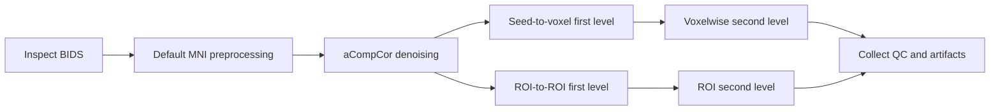

# Pipeline construction and lifecycle

## Supported templates

The executable beta contains two complete, versioned templates:

| Template | First level | Second level | Minimum regions |
| --- | --- | --- | ---: |
| `rsfmri_seed_to_voxel@1.0.0` | seed-based voxel maps | voxelwise GLM | 1 |
| `rsfmri_roi_to_roi@1.0.0` | ROI correlation matrices | ROI-level GLM | 2 |

Both require raw BIDS data, one session per subject, MNI normalization, and either
a one-sample or two-independent-group design. Continuous covariates and multiple
explicit contrasts are supported within those designs.

## Directed stage graph

Each node identity includes its module version, the project fields it consumes,
and the identities of upstream nodes. This permits deterministic invalidation:

| Changed input | Earliest invalidated stage |
| --- | --- |
| dataset or subject set | inspection |
| preprocessing parameter | preprocessing |
| denoising parameter | denoising |
| seed or ROI selection | first level |
| groups, covariates, or contrasts | second level |

The current engine reuses an identical completed job and can recalculate a second
level from retained first-level results after a reviewed sample changes. Cross-
project reuse of arbitrary intermediate derivatives is not yet automatic.

## From question to execution

1. The client calls `get_product_capabilities` and `list_datasets`.
2. The researcher defines the question, analysis family, regions, groups,
   covariates, contrasts, and hypotheses.
3. `compose_pipeline` or `start_available_flow` creates a project.
4. The parameter resolver enumerates unresolved scientific choices.
5. Each choice is resolved with an evidence record, rationale, and explicit value.
6. Preflight resolves acquisition requirements such as BIDS slice timing.
7. `generate_execution_plan` freezes the validated inputs and graph identities.
8. `run_available_flow` reuses the current compatible job or queues one new job.
9. The worker executes one CONN project at a time. `parallel_jobs` controls
   subject-level CONN processes inside that project.

The engine rejects unknown fields, unsupported values, incomplete groups,
inconsistent covariates, invalid contrasts, and unresolved required parameters.
