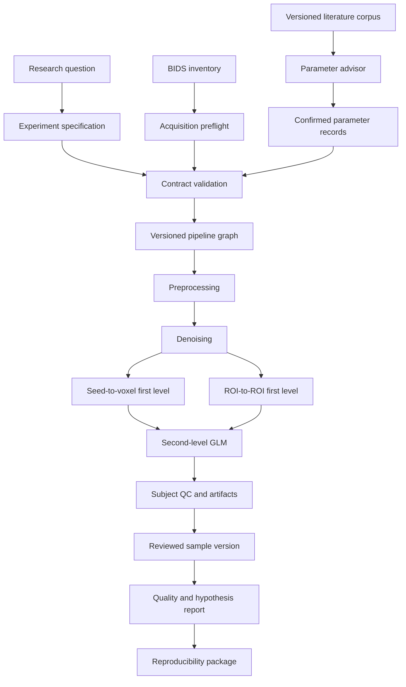

# Scientific module reference

This page explains the scientific behavior of CONN Pilot at the level needed to
evaluate, audit, or reproduce a study. It intentionally omits hosting providers,
credentials, private addresses, machine paths, and operational recovery
procedures. The versioned catalog and contracts remain authoritative when prose
and executable behavior differ.

## The governing separation

CONN Pilot keeps six objects distinct throughout the workflow:

1. a structured observation extracted from a paper;
2. an AI-generated comparison or proposal;
3. an investigator-confirmed methodological decision;
4. a validated, immutable execution plan;
5. technical and statistical outputs from CONN;
6. a versioned scientific interpretation.

The language model explains choices and translates the research question. The
deterministic modules validate types, ranges, identities, dependencies, versions,
and evidence alignment. CONN Toolbox performs the numerical image and
connectivity analysis. The investigator remains responsible for methodological
and scientific judgment.

## 1. Experiment specification

The experiment-design module converts a question into a typed project rather
than executable MATLAB. Its inputs are:

- a registered dataset identifier;
- a versioned analysis family;
- a research question;
- selected seeds or ROIs;
- subjects and a one-sample or two-independent-group design;
- optional continuous covariates;
- one or more named contrasts;
- an optional operationalized hypothesis;
- parameter records and their provenance.

Each contrast names the between-subject effects it uses, supplies a weight for
each effect, records a rationale, and requires confirmation. Group membership
must cover the declared sample without duplicates. Covariates must provide a
finite value for every relevant subject. Contrast dimensions must match their
effects.

An operationalized hypothesis records a statement, target contrast, expected
direction, decision rule, multiplicity method, and optionally a prospective
sample-adequacy argument. This definition is stored before interpretation so the
result is not silently reframed after inspection.

The output is a project specification. It is a scientific intent, not yet a job.
Unsupported fields, designs, regions, or values are rejected instead of being
translated approximately.

## 2. Dataset inspection and acquisition preflight

The dataset module inspects registered raw BIDS inputs and creates a path-free
inventory containing subjects, sessions, modalities, repetition time, and
available acquisition metadata. It checks that each included subject has the
structural and functional inputs required by the selected pipeline.

The acquisition preflight then resolves metadata that affects execution. The
current explicit case is slice timing. It follows BIDS metadata inheritance and
records one of four states:

- `resolved`: exact metadata is available;
- `resolved_with_omission`: an explicit policy omits the operation;
- `unresolved`: execution is blocked pending a decision;
- `not_applicable`: the requirement does not apply.

If `SliceTiming` is present, the staged BIDS metadata is preserved and CONN is
instructed to use the BIDS order. If it is absent, CONN Pilot never guesses an
order. The investigator may provide exact acquisition information, identify an
authoritative source, or explicitly omit slice-time correction with the
scientific consequence recorded. The resulting `preflight.json` becomes part of
the execution provenance.

## 3. Seed and ROI catalog

The region module resolves human-readable identifiers to built-in CONN sources.
The current release exposes atlas, network, and Schaefer regions through a
searchable catalog. Seed-to-voxel requires at least one region; ROI-to-ROI
requires at least two.

A region record contains the stable catalog identifier, the exact CONN source
name, and the investigator's rationale. This prevents an AI client from silently
substituting a similarly named region. Subject-specific ROI files and arbitrary
external ROI definitions are outside the current executable contract.

## 4. Literature evidence corpus

The evidence module is a versioned normalization of the literature used for
method guidance. It contains 138 indexed papers and 45 structurally reviewed
pipeline instances in this release. For reviewed papers it represents method
components, execution context, reported parameter values, source sections,
discrepancies, and unresolved questions.

Every parameter observation receives an evidence identifier and one of these
statuses:

- `explicit`: directly reported by the source;
- `inferred`: reconstructed from incomplete reporting;
- `not_reported`: unavailable from the source.

The corpus records precedent and traceability. It is not an automated
meta-analysis, effect-size synthesis, or universal ranking of methods. The 93
unreviewed inherited records are not promoted to executable guidance as though
they had been checked against full text. Full copyrighted papers are not
redistributed.

## 5. Literature advisor and parameter resolver

The advisor exposes the corpus to the AI client. It can list topics, retrieve
observations, compare reported values, and return the normalized record for a
paper. The AI can explain how options differ, but the resolver enforces the
scientific decision contract.

Seven parameters require an explicit cited decision:

| Scientific parameter | Executable destination |
| --- | --- |
| smoothing FWHM in millimetres | `Setup.preprocessing.fwhm` |
| ART displacement threshold | second ART threshold |
| ART global-signal z threshold | first ART threshold |
| white-matter aCompCor components | white-matter confound dimension |
| CSF aCompCor components | CSF confound dimension |
| temporal pass band in Hz | `Denoising.filter` |
| global-signal regression policy | explicit no-GSR policy in this release |

For each parameter the resolver performs the following deterministic steps:

1. loads its type, range, implemented values, and CONN mapping from the selected
   pipeline version;
2. loads relevant acquisition context such as TR;
3. retrieves only mapped observations from the frozen corpus;
4. normalizes units and representations;
5. removes values that violate the executable contract or the sampling/Nyquist
   constraints;
6. groups the remaining values and returns their evidence identifiers;
7. validates that the chosen value has an exact normalized match in at least one
   cited `explicit` observation;
8. stores the chosen value, rationale, evidence snapshot, corpus version, and
   investigator confirmation.

Observation count is displayed as descriptive frequency. It is never converted
into an automatic recommendation. Scientific suitability is deliberately not
claimed by the validator. The reference values used in benchmark projects, such
as 8 mm smoothing or a 0.008–0.09 Hz band, are records of those projects rather
than hidden defaults for future studies.

The current executable GSR choice is `false`. That restriction is exposed as a
capability limit; the system must not pretend to have evaluated a GSR-enabled
alternative it cannot execute.

## 6. Versioned pipeline catalog and graph composer

The catalog defines analysis families, stage versions, compatibility, required
inputs, produced artifacts, and the project fields consumed by each stage. The
current complete templates are:

| Pipeline | First-level product | Second-level product |
| --- | --- | --- |
| `rsfmri_seed_to_voxel@1.0.0` | one voxel map per selected source and subject | voxelwise group model |
| `rsfmri_roi_to_roi@1.0.0` | ROI connectivity matrices | ROI-level group model |

The composer produces a directed acyclic graph from a validated template. Each
node has a content identity derived from its module/version, relevant project
fields, and upstream node identities. This makes invalidation explainable:

- changing subjects or dataset invalidates from inspection;
- changing preprocessing invalidates from preprocessing;
- changing denoising invalidates from denoising;
- changing regions invalidates from first level;
- changing groups, covariates, or contrasts invalidates from second level.

The user can preview this impact before saving a change. The current engine can
reuse an identical completed job and can recompute a second level from retained
first-level products. It does not yet promise arbitrary cross-project reuse of
intermediate images.

## 7. Preprocessing module

The preprocessing stage uses the validated `default_mni` family on one resting-
state session per subject. With complete BIDS slice timing, CONN receives the
named default pipeline and `sliceorder='BIDS'`. When omission was explicitly
authorized, CONN Pilot constructs the supported sequence without a slice-time
step:

1. label and center functional and structural inputs;
2. functional realignment and unwarping;
3. ART outlier detection with the confirmed thresholds;
4. functional-to-structural affine coregistration;
5. direct functional segmentation and normalization to MNI space;
6. structural segmentation and normalization;
7. functional smoothing with the confirmed FWHM.

The module writes the smoothing and ART values directly into the CONN batch.
Inputs are protected staged copies, so preprocessing does not modify the source
BIDS dataset. This release validates MNI normalization and does not expose a
free-form menu of alternative preprocessing sequences.

## 8. Denoising module

The denoising stage configures CONN with four confound families:

- white-matter aCompCor components;
- CSF aCompCor components;
- realignment regressors with the configured dimension and derivative handling;
- ART scrubbing regressors.

The chosen WM and CSF component counts are written to the corresponding CONN
confound dimensions. Scrubbing retains all generated outlier regressors. The
module also applies the confirmed temporal filter, detrending order, and
despiking setting. The reference execution uses linear detrending and disables
despiking, but these records remain explicit rather than implicit behavior.

Global-signal regression is disabled by an explicit policy. The module does not
silently regress the global signal and does not interpret aCompCor as equivalent
to GSR.

## 9. Seed-to-voxel first level

For `rsfmri_seed_to_voxel`, CONN Pilot configures a named SBC analysis using the
selected sources and CONN's bivariate-correlation measure. For every subject and
source, CONN estimates the relationship between the source time series and each
voxel after denoising. The durable first-level product is the set of source-based
voxel maps needed by the group model.

The module determines which source names and analysis type CONN receives; CONN
performs the numerical estimation. The system does not infer a seed from the
hypothesis text, merge seeds, or choose a laterality unless that region was
explicitly selected.

## 10. ROI-to-ROI first level

For `rsfmri_roi_to_roi`, the same denoised data feed a named RRC analysis using
at least two selected sources and the bivariate-correlation measure. CONN creates
subject-level connectivity matrices among the selected regions.

The ROI-to-ROI and seed-to-voxel templates share the same scientific stages
through denoising. The current engine does not yet promise automatic derivative
reuse across distinct projects, even when those upstream definitions are
compatible. The current contract does not expose graph-theory metrics, dynamic
connectivity, PPI, or arbitrary matrix post-processing as part of this module.

## 11. Second-level design and contrasts

The second-level module converts the declared design into CONN subject effects:

- `AllSubjects` is a vector of ones;
- every group is a binary membership vector;
- every continuous covariate is a subject-aligned numeric vector.

Each named contrast selects effects and weights explicitly. The condition is the
single resting-state condition, and selected sources are evaluated without an
interactive display step. Seed-to-voxel creates voxelwise CONN/SPM group models;
ROI-to-ROI creates ROI-level group models.

Supported designs are one sample and two independent groups, optionally with
continuous covariates and multiple explicit contrasts. Longitudinal, repeated-
measures, mixed-effects, arbitrary factorial, and subject-specific ROI designs
are rejected. Statistical display thresholds are not silently chosen by this
pipeline version.

## 12. Deterministic batch generation and provenance

Once validation succeeds, the engine renders a MATLAB batch from the frozen
project and preflight records. It does not execute AI-generated MATLAB. The batch
contains subject inputs, TR, conditions, effects, preprocessing, denoising,
analysis type, sources, and contrasts in a stable structure.

The system records the project version, graph and plan fingerprints, batch hash,
software compatibility, attempt identity, timestamps, and output hashes. A
remote job represents durable scientific intent; a local execution is a
replaceable attempt. Repeating publication of the same content does not create a
different scientific identity.

Progress telemetry reports stage, active subjects, durable completed units,
recent activity, and an approximate percentage. The percentage is operational
evidence of progress, not a scientific result and not a guarantee of remaining
wall time.

## 13. Subject-level QC module

After execution, the QC module collects visual and numeric evidence for every
subject. Visual evidence can include structural-to-MNI, functional-to-MNI,
functional-to-anatomical registration, grey-matter segmentation, ART time
series, and before/after denoising views.

Numeric evidence includes, when available:

- acquired volume count;
- ART outlier count and percentage;
- retained volume count;
- longest consecutive outlier run;
- maximum global-signal z value;
- maximum and mean motion;
- median temporal SNR;
- mean and maximum DVARS;
- the thresholds used to generate the ART flags.

The system may identify unusual evidence for inspection. It does not automatically
exclude a subject. The investigator records `accept`, `exclude`, or
`needs_review`; exclusion requires a rationale. Decisions are append-only and
bound to the result version and subject.

## 14. Sample versioning and second-level recalculation

The effective sample is the ordered set of accepted subjects and is represented
by a SHA-256-derived sample version. If a QC decision changes the sample, the old
second-level result remains preserved but becomes stale for the new sample.

Scientific acceptance is blocked until a second-level model exists for the
current sample version. Recalculation reuses compatible first-level results and
creates a new group-model/output version. This prevents a report from combining
QC decisions from one sample with statistics from another.

## 15. Experiment-quality and hypothesis module

The quality report applies four gates before interpreting a hypothesis:

1. required technical stages and artifacts completed;
2. every subject has a current QC decision;
3. the effective sample is non-empty;
4. the second-level result matches the effective sample.

It then checks whether inferential evidence is complete and version-bound. The
evidence must identify the contrast, effect estimate, confidence interval or
p-value, multiplicity method, result version, and sample version. The registered
hypothesis must identify the expected direction and decision rule.

The possible classifications are:

- `not_evaluable_quality`: a quality gate failed;
- `not_evaluable_inference`: inferential evidence is absent, incomplete, or
  belongs to another version;
- `inconclusive`: evidence is usable but does not satisfy the registered rule,
  or the hypothesis was insufficiently operationalized;
- `evidence_compatible`: the registered rule is met in the expected direction;
- `evidence_not_compatible`: qualifying evidence points in the opposite
  direction.

`evidence_compatible` means compatibility under the declared model and rule. It
does not prove the hypothesis true. Non-significance does not prove absence of an
effect. Sample adequacy is reported separately; satisfying the technical minimum
does not establish statistical power or precision.

## 16. Scientific-decision record

The investigator's scientific decision is stored independently from the
automated quality report. The record can express acceptance, rejection, or need
for further review, with rationale and version bindings. The software prevents
acceptance when QC is incomplete or the second-level model is stale, but it does
not manufacture scientific acceptance from a significant p-value.

This separation permits an investigator to disagree with an automated
classification while preserving both records for audit.

## 17. Reproducibility package

The export module binds the complete audit trail into a versioned ZIP. It can
contain:

- HTML, PDF, and JSON reports;
- the experiment-quality report;
- a generated methods description;
- exact parameter records;
- literature evidence identifiers and snapshots;
- subject QC decisions;
- derivative dataset metadata;
- current statistical artifacts permitted for export;
- an artifact manifest with content hashes.

The package records the result, sample, and second-level versions. It does not
contain source neuroimages and cannot substitute for the original BIDS dataset,
licensed software, atlases, or full copyrighted papers.

## Supported scope and current scientific limits

The validated beta scope is intentionally narrow:

- resting-state fMRI from raw BIDS;
- one session per subject;
- MNI normalization;
- built-in CONN regions;
- seed-to-voxel or ROI-to-ROI connectivity;
- one-sample or two-independent-group designs;
- optional continuous covariates and explicit contrasts.

The executable contract does not currently cover repeated measures,
longitudinal designs, arbitrary MATLAB, subject-specific ROIs, task connectivity,
PPI, dynamic connectivity, graph analysis, automatic power analysis, automatic
subject exclusion, or complete parameter-level risk-of-bias appraisal.

## Where to verify each claim

| Concern | Machine-readable or executable source |
| --- | --- |
| supported pipelines and parameter mappings | `catalog/pipelines/` and `catalog/stages/` |
| project and hypothesis validation | `src/conn_pilot/project.py` |
| region resolution | `src/conn_pilot/seed_catalog.py` |
| literature normalization | `src/conn_pilot/literature.py` and `knowledge/pipeline_review/` |
| cited parameter decisions | `src/conn_pilot/parameter_resolver.py` |
| graph identities and invalidation | `src/conn_pilot/pipeline_graph.py` |
| acquisition decisions | `src/conn_pilot/preflight.py` |
| CONN batch construction | `src/conn_pilot/adapter.py` |
| artifacts and run manifest | `src/conn_pilot/results.py` and `src/conn_pilot/jobs.py` |
| quality and hypothesis logic | `src/conn_pilot/quality_report.py` |
| reproducibility archive | `src/conn_pilot/reporting.py` |
| stable external behavior | `contracts/` |

Tests in `tests/` exercise these boundaries with synthetic data and mocked
execution surfaces. A passing test suite establishes implementation consistency;
it does not establish clinical validity or general scientific validity.
